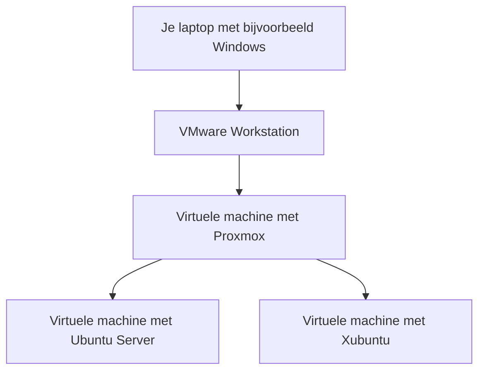

# Virtuele machines met Proxmox

Stel: je wilt de temperatuur van een lokaal op een website tonen. Je hebt een sensor die meet en een computer die de website aanbiedt. Je wilt de website ook testen. Dat doe je vanaf een tweede computer met een browser.

Voor dit labo heb je geen twee extra computers nodig. Je maakt twee **virtuele machines**. Dat zijn computers die met software worden nagebouwd. Je kunt er een besturingssysteem op installeren, programma's starten en bestanden bewaren. **VM** komt van *Virtual Machine*: Engels voor virtuele machine. Een besturingssysteem, bijvoorbeeld Windows of Ubuntu, heet in Engelse documentatie een **OS** (*Operating System*).

We bouwen eerst een gewone website. De sensorgegevens komen later in de cursus aan bod.

## 1. Wat gaan we maken?

Je gebruikt drie onderdelen:

| Onderdeel | Wat doet het in ons labo? |
| --- | --- |
| Proxmox | Hiermee maak en beheer je de virtuele machines. |
| Ubuntu Server | Deze virtuele machine bewaart je website en verstuurt de pagina naar een browser. |
| Xubuntu | Op deze virtuele machine open je de website in een browser. |

Ubuntu Server is dus de **server**: de computer die iets aanbiedt. Xubuntu is de **client**: de computer die er gebruik van maakt.

Je kent dat al van een bezoek aan een website. Je browser vraagt een pagina op. Een webserver stuurt die pagina terug. In dit labo beheer je zelf de server én de client.

## 2. Wat doet een hypervisor?

Een gewone computer heeft een processor, werkgeheugen, opslag en een netwerkkaart. Een virtuele machine heeft die onderdelen ook, maar dan in een virtuele vorm.

Een **hypervisor** is de software die dat mogelijk maakt. Hij verdeelt de onderdelen van de echte computer over de virtuele machines.

Zo kun je op één computer tegelijk een Linux-machine en een Windows-machine laten draaien. Elke machine heeft haar eigen besturingssysteem en bestanden. Je kunt de ene afsluiten terwijl de andere verder werkt.

Er blijft wel één echte computer onder zitten. Zet je die uit, dan stoppen alle virtuele machines die erop draaien.

Twee woorden die je in documentatie vaak ziet:

- **Host:** de computer waarop de virtuele machines draaien.
- **Gast:** het besturingssysteem dat in een virtuele machine draait.

**Voorbeeld:** draait Ubuntu in een virtuele machine op je Windows-laptop? Dan is de laptop de host en Ubuntu de gast.

### Type I en type II

Er zijn twee veelgebruikte manieren om een hypervisor te gebruiken.

**Type I:** je installeert de software voor virtualisatie rechtstreeks op een server. Proxmox gebruikt daarvoor **KVM** (*Kernel-based Virtual Machine*). Dat is het Linux-onderdeel dat de virtuele machines laat draaien. *Kernel* betekent de kern van een besturingssysteem: die regelt onder andere processor, geheugen en toegang tot apparaten. Je beheert de virtuele machines via de Proxmox-website. Dit is een gebruikelijke aanpak op servers.

**Type II:** je installeert een programma zoals VMware Workstation of VirtualBox op je bestaande Windows- of Linux-computer. Je opent dat programma en maakt daarin virtuele machines.

Proxmox is de naam van het beheerplatform. **KVM** is het onderdeel dat de virtuele machines laat draaien. Je hoeft in dit hoofdstuk niet alle onderdelen van Proxmox te kennen. [Meer over Proxmox](https://www.proxmox.com/en/products/proxmox-virtual-environment/features)

### Een virtuele machine in een virtuele machine

Op je eigen laptop gebruiken we mogelijk deze opstelling:

1. Je start je laptop, bijvoorbeeld met Windows.
2. Je opent VMware Workstation.
3. Daarin start je een virtuele machine met Proxmox.
4. In Proxmox start je Ubuntu Server en Xubuntu.

Dat heet **nested virtualisatie**. Het woord *nested* betekent hier dat de ene virtuele omgeving in de andere zit.



Workstation moet de virtualisatiefunctie van de processor doorgeven aan Proxmox. Daarvoor bestaat een instelling in Workstation. Staat die niet goed, dan kan Proxmox starten terwijl Ubuntu en Xubuntu niet willen starten.

Werk je op een Proxmox-server van de opleiding? Dan zijn de bovenste laptopstappen niet nodig.

**Even controleren:** Ubuntu start niet en Proxmox toont een fout over KVM. Kijk je dan eerst naar de instelling voor virtualisatie of naar het IP-adres van Ubuntu?

## 3. Hoeveel krijgt elke machine?

Wanneer je een virtuele machine maakt, kies je hoeveel processor, geheugen en opslag ze krijgt. In documentatie heten die onderdelen samen ook **resources**.

### Processor: het rekenwerk

**CPU** betekent *Central Processing Unit*: de processor die instructies uitvoert. Bij een VM zie je **vCPU**, de virtuele versie van zo’n processor.

In dit labo krijgt elke Linux-machine twee vCPU's. Daarmee kan ze rekenwerk laten uitvoeren op de echte processor. Die processor moet zijn tijd wel verdelen over alle machines die draaien.

**Voorbeeld:** Ubuntu installeert updates terwijl Xubuntu een programma installeert. Beide vragen dan tegelijk rekenwerk. Ze kunnen daardoor trager reageren. Meer vCPU's invullen maakt de echte processor niet krachtiger.

### RAM: het werkgeheugen

**RAM** betekent *Random Access Memory*: het werkgeheugen. Programma’s gebruiken het terwijl ze draaien. Je bestanden voor later bewaar je op de schijf.

Stel dat je Proxmox-VM 8 GB RAM krijgt. Die 8 GB verdelen we zo:

| Waarvoor? | Hoeveel? |
| --- | --- |
| Ubuntu Server | 2 GB |
| Xubuntu | 3 GB |
| Over voor Proxmox en zijn eigen werk | Ongeveer 3 GB |

Ubuntu en Xubuntu gebruiken dus samen 5 GB van de 8 GB. Ze komen daar niet nog eens bovenop.

Windows of Linux op je laptop heeft zelf ook RAM nodig. Geef daarom niet al het geheugen van je laptop aan Proxmox.

### Opslag: je bestanden bewaren

Elke virtuele machine krijgt een virtuele schijf. Daarop staan het besturingssysteem, de programma's en je bestanden.

We geven beide Linux-machines een schijf van 24 GB. Die schijven gebruiken uiteindelijk ruimte op de echte opslag. Een **SSD** (*Solid State Drive*) bewaart gegevens in geheugenchips. Een klassieke harde schijf heet ook **HDD** (*Hard Disk Drive*) en heeft draaiende schijven. **GB** betekent gigabyte, een eenheid voor de hoeveelheid gegevens.

Je komt daarbij de term **thin provisioning** tegen. Dat werkt zo:

- De virtuele machine ziet bijvoorbeeld een schijf van 24 GB.
- Staan er nog maar enkele GB aan bestanden op, dan hoeft die schijf op de host nog niet de volle 24 GB in te nemen.
- Naarmate je bestanden toevoegt, groeit de gebruikte ruimte op de host.

Je moet dus op meer dan één plaats vrije ruimte controleren. Ubuntu kan nog ruimte tonen, terwijl de opslag van Proxmox bijna vol is. Ook de SSD van je laptop kan vol raken.

Met `df -h` bekijk je de vrije ruimte **in de Linux-machine waarin je het commando uitvoert**. De vrije ruimte van Proxmox bekijk je apart in zijn beheerpagina.

### Twee namen die je tijdens het aanmaken ziet

**VirtIO** is de naam van virtuele apparaten die speciaal zijn gemaakt voor samenwerking met een hypervisor. Linux gebruikt er **drivers** voor: kleine besturingsprogramma’s waarmee het een apparaat bedient. Je kiest VirtIO voor onder andere de virtuele schijf en netwerkkaart. We gebruiken die keuze in het labo.

**QEMU** is de naam van software die meehelpt om de virtuele computer op te bouwen. De **QEMU Guest Agent** is een klein hulpprogramma in de Linux-machine. *Guest* betekent gast en *agent* betekent hier helper. Het geeft bijvoorbeeld informatie over die machine door aan Proxmox. Je installeert het in Ubuntu en Xubuntu en zet de bijbehorende optie aan in Proxmox.

## 4. Hoe vinden de machines elkaar?

Je website werkt pas als Xubuntu contact kan maken met Ubuntu Server. Daarvoor krijgen beide machines een netwerkkaart en een IP-adres. Elke virtuele netwerkkaart heeft ook een **MAC-adres** (*Media Access Control*), haar herkenningsadres in het lokale netwerk. Dat is iets anders dan het IP-adres dat je in Linux instelt. Een nieuw MAC-adres maakt een gekopieerd vast IP-adres dus niet vanzelf anders.

### De bridge: een virtuele switch

In Proxmox zie je een netwerkonderdeel met de naam `vmbr0`. Dat is een **bridge**. Je kunt die vergelijken met een **switch**: een apparaat dat computers in hetzelfde netwerk met elkaar verbindt. Aan de virtuele switch hangen virtuele netwerkkaarten in plaats van echte kabels.

In ons labo verbind je beide machines met die bridge. Via de bridge kunnen ze ook het voorbereide netwerk buiten Proxmox bereiken.

Alleen een bridge aanmaken is niet genoeg voor internet. Daarvoor moet er ook een verbinding met een router zijn. De docent helpt je controleren welk netwerk je gebruikt.

### Vier instellingen die je nodig hebt

**IP** betekent *Internet Protocol*: de afspraken voor het adresseren en doorsturen van netwerkverkeer. Een **IP-adres** is het adres van een netwerkkaart. Wij gebruiken **IPv4**, de versie met adressen zoals `192.168.77.100`.

Voor Ubuntu Server gebruiken we dit voorbeeld:

| Instelling | Voorbeeld | Waarvoor dient het? |
| --- | --- | --- |
| IP-adres | `192.168.77.100` | Het adres van je server. Xubuntu gebruikt dit om je website te vinden. |
| Subnetmasker | `/24` of `255.255.255.0` | Hiermee bepaalt de machine welke adressen bij haar eigen netwerk horen. |
| Gateway | `192.168.77.2` | De router waarlangs je andere netwerken, zoals internet, bereikt. |
| DNS-server | `192.168.77.2` | Zoekt het IP-adres op dat bij een naam hoort. |

De gateway en DNS-server hebben hier hetzelfde adres, omdat één apparaat beide taken doet. Dat hoeft niet in elk netwerk zo te zijn.

Xubuntu krijgt in het voorbeeld `192.168.77.200/24`. De twee machines zitten in hetzelfde netwerk en kunnen elkaar rechtstreeks bereiken. Voor een download van internet gebruiken ze de gateway.

**DNS** betekent *Domain Name System*: de dienst die adressen bij namen opzoekt.

**DNS-voorbeeld:** je vraagt `archive.ubuntu.com` op. De DNS-server zoekt welk IP-adres daarbij hoort. Zonder werkende DNS kan een software-installatie mislukken, ook als je de server nog via zijn IP-adres kunt bereiken.

Gebruik de adressen van je **verslag**. De voorbeeldadressen werken alleen als dat netwerk ook echt is ingesteld.

### Een vast adres of DHCP

**DHCP** betekent *Dynamic Host Configuration Protocol*. Met die afspraken kan een computer automatisch een IP-adres en andere netwerkinstellingen krijgen. Met een **vast IP-adres** vul je die zelf in.

We geven onze server een vast adres. Zo hoef je het adres van je website niet telkens opnieuw te zoeken.

De docent bevestigt welke adressen je mag gebruiken. Ze mogen niet tegelijk door DHCP aan een andere machine worden uitgedeeld. Twee machines met hetzelfde adres kunnen elkaars verbinding verstoren.

In ons voorbeeld zijn `192.168.77.0` en `192.168.77.255` speciale netwerkadressen. Die geef je niet aan je VM's.

### Naar internet via NAT

Bij de laptopopstelling gebruiken we meestal **NAT** (*Network Address Translation*, adresvertaling) in Workstation. Daarmee kunnen je virtuele machines via je laptop een verbinding met internet maken. Workstation vertaalt hun netwerkadressen en stuurt de antwoorden terug naar de juiste machine.

Dat betekent nog niet dat je telefoon de website kan openen. Je telefoon zit bijvoorbeeld op wifi, terwijl je VM's in een apart virtueel netwerk zitten. Daar moet eerst een verbinding tussen zijn. Vandaag testen we daarom vanuit Xubuntu.

### Waar stel je dit in?

Op **Ubuntu Server** vul je het vaste adres in tijdens de installatie. De instellingen komen in een tekstbestand terecht. **Netplan** leest dat bestand en past de instellingen toe.

Op **Xubuntu** gebruiken we **NetworkManager**. Dat programma bewaart de instellingen in een verbindingsprofiel. We passen dat profiel aan met het commando `nmcli`.

De oplossingen tonen beide manieren. Voer netwerkcommando's uit in de console van de juiste VM. Dat is het scherm dat je in Proxmox opent, alsof je rechtstreeks voor die virtuele computer zit. Zo kun je nog bij de machine als je de netwerkverbinding per ongeluk verbreekt.

## 5. Een website openen is ook een test

Op Ubuntu Server installeren we **NGINX**. Dat is de naam van een webserver: software die webpagina’s naar een browser stuurt.

De inhoud en structuur van zo’n pagina schrijf je in **HTML** (*HyperText Markup Language*). De opmaak, zoals kleuren en lettergroottes, schrijf je in **CSS** (*Cascading Style Sheets*). Je gebruikt dus twee soorten bestanden voor twee taken.

Op Xubuntu open je daarna:

```text
http://192.168.77.100
```

Verschijnt de pagina? Dan weet je dat de browser de webserver bereikt en een pagina terugkrijgt.

### Waarvoor dient een poort?

Op één computer kunnen meerdere programma's via het netwerk bereikbaar zijn. Een **poortnummer** helpt de verbinding bij het juiste programma te brengen.

| Wat wil je doen? | Poort in dit labo |
| --- | --- |
| Proxmox beheren in de browser | TCP 8006 |
| Op Ubuntu aanmelden met SSH | TCP 22 |
| De website openen via HTTP | TCP 80 |

**HTTP** betekent *Hypertext Transfer Protocol*: de afspraken waarmee de browser een webpagina opvraagt en de server antwoordt. **HTTPS** is de beveiligde vorm: de verbinding wordt versleuteld.

**TCP** betekent *Transmission Control Protocol*. Het verzorgt een verbinding die gegevens in de juiste volgorde aflevert en ontbrekende gegevens opnieuw kan versturen. HTTP en SSH gebruiken in ons labo TCP.

Bij gewoon HTTP gebruikt de browser automatisch poort 80. Daarom hoef je `:80` niet achter het adres te typen. Bij Proxmox typ je wel `:8006`.

### Ping en de browser testen iets anders

Met `ping` controleer je of de andere machine antwoordt op een klein testbericht.

Maar de machine kan antwoorden terwijl NGINX uitstaat. De website werkt dan niet. Je test de website dus ook met een browser of met `curl`:

```bash
curl -I http://192.168.77.100
```

`curl` vraagt hier een antwoord aan de webserver. Met `-I` toon je de antwoordinformatie in plaats van de volledige HTML. Een antwoord zoals `200 OK` betekent dat de webserver je vraag met succes heeft verwerkt.

### Wat betekent localhost?

`localhost` betekent **de computer waarop je nu werkt**.

- Typ je op Ubuntu Server `curl http://localhost`? Dan test je de webserver op Ubuntu Server.
- Typ je dat op Xubuntu? Dan zoek je een webserver op Xubuntu.

In het tweede geval test je dus niet je Ubuntu Server. Om die vanaf Xubuntu te testen, gebruik je het serveradres.

## 6. Bestanden op de server zetten

**SSH** betekent *Secure Shell*. Daarmee open je vanaf Xubuntu een **terminal** op Ubuntu Server: een venster waarin je commando’s typt. Je voert dan commando's op de server uit, zonder steeds zijn scherm in Proxmox te openen.

Bij de eerste verbinding toont SSH een code die bij de server hoort: de **vingerafdruk van de hostsleutel**. Je vergelijkt die met de code in de serverconsole. Zo controleer je of je met de juiste server verbindt.

**SFTP** betekent *SSH File Transfer Protocol*. Daarmee stuur je bestanden naar de server via dezelfde SSH-verbinding. Je gebruikt het om je HTML en CSS te uploaden. Je zet de bestanden eerst in je eigen gebruikersmap.

NGINX zoekt de website in dit labo in `/var/www/html`. Dat heet de **webroot**: de map waarin de website staat. Na de upload verplaats of kopieer je de bestanden met beheerdersrechten naar die map.

### Wie mag de bestanden aanpassen?

Linux houdt per bestand bij wie het mag lezen of wijzigen.

Voor onze website maken we deze afspraak:

- Jij past de bronbestanden aan in je eigen map.
- Je plaatst de afgewerkte bestanden met `sudo install` in de webmap.
- NGINX mag de bestanden lezen om ze naar de browser te sturen.
- NGINX mag de bestanden zelf niet wijzigen.

NGINX gebruikt in Ubuntu de gebruiker `www-data` voor het verwerken van webvragen. De gepubliceerde bestanden worden van `root`, de beheerder. Zo hoeft `www-data` geen eigenaar van de website te zijn.

In de oplossing zie je `0644` bij bestanden en `0755` bij mappen. Kort gezegd: de eigenaar mag aanpassen, de anderen mogen de website lezen en de map openen. `chmod 777` zou iedereen schrijfrechten geven. Dat hebben we hier niet nodig.

### De firewall

Een **firewall** bepaalt welke netwerkverbindingen worden toegelaten. Op Ubuntu gebruiken we daarvoor **UFW** (*Uncomplicated Firewall*), een programma waarmee je die regels instelt. We laten op onze Ubuntu Server SSH en HTTP toe vanuit het labnetwerk.

Je voegt de SSH-regel toe vóór je de firewall aanzet. Anders kun je je eigen SSH-verbinding blokkeren. Daarom houd je ook de Proxmox-console bij de hand.

## 7. Wat doe je als de website niet werkt?

Verander niet meteen vijf instellingen. Begin met één test en kijk wat het resultaat zegt.

| Vraag | Wat doe je? |
| --- | --- |
| Staat de server aan? | Kijk in Proxmox of de VM draait. |
| Heeft hij het juiste adres? | Voer op de server `ip -br address` uit. |
| Antwoordt de server? | Ping vanaf Xubuntu het serveradres. |
| Staat NGINX aan? | Voer op de server `systemctl status nginx` uit. |
| Werkt de website op de server zelf? | Voer daar `curl -I http://localhost` uit. |
| Werkt de website vanaf Xubuntu? | Open daar het serveradres in de browser. |

**Voorbeeld uit het labo:** je stopt NGINX. Ping blijft werken, maar de browser toont geen pagina meer. Je start NGINX weer. De pagina verschijnt opnieuw. Je hebt nu gezien dat een werkende netwerkverbinding en een werkende website twee aparte dingen zijn.

Een foutmelding kan ook helpen. Bij `403 Forbidden` heb je al een webserver bereikt, maar krijg je geen toegang tot de gevraagde inhoud. Dan kijk je bijvoorbeeld naar de map en de leesrechten.

## 8. Een vorige toestand terugzetten

Je gaat iets aan je website veranderen. Wat als je daarna terug wilt naar de versie van ervoor?

### Snapshot: terug naar vóór je wijziging

Een **snapshot** bewaart een toestand waarnaar je kunt terugkeren. In dit labo sluit je de VM eerst netjes af en maak je dan de snapshot.

Daarna start je de VM en verander je een zin op de website. Zet je de snapshot terug, dan verschijnt de oude zin weer. Het terugzetten heet in Proxmox **rollback**.

Let op: ook andere wijzigingen sinds die snapshot verdwijnen bij het terugzetten. Maak dus geen nieuwe belangrijke bestanden tijdens deze proef.

Een snapshot hangt af van dezelfde opslag als de VM. Gaat die opslag verloren, dan kun je ook je snapshot verliezen.

### Back-up: een aparte herstelkopie

Een **back-up** is een aparte kopie waarmee je een machine opnieuw kunt opbouwen. We bewaren die op de plaats die de docent opgeeft.

Een kopie op een andere fysieke schijf of server kan je helpen wanneer de oorspronkelijke schijf stukgaat. Een extra bestand op dezelfde laptop beschermt je niet tegen verlies van die laptop.

Je weet pas of de back-up bruikbaar is als je hem ook terugzet en test. Dat noemen we een **restore**.

### Waarom starten we de kopie zonder netwerk?

De herstelde machine bevat nog het IP-adres van het origineel. Start je beide op hetzelfde netwerk, dan gebruiken ze hetzelfde adres. Dat veroorzaakt problemen.

Daarom herstellen we naar een nieuw VM-nummer en koppelen we de netwerkkaart van de kopie los vóór het starten. We openen haar console en testen de website met `localhost`. Daarvoor is geen netwerkverbinding met Xubuntu nodig.

Na de test sluiten we de kopie af. De originele server blijft bewaard voor het volgende hoofdstuk.

## 9. Kun je dit al uitleggen?

Gebruik je eigen opstelling om te antwoorden.

1. Je zet de laptop uit waarop Proxmox draait. Wat gebeurt er met Ubuntu Server en Xubuntu?
2. Je verbindt beide VM's met `vmbr0`. Met welk bekend netwerkapparaat kun je dat vergelijken? Waarvoor vul je daarnaast een gateway in?
3. Je stopt NGINX. Waarom kan ping nog werken terwijl je website niet meer opent?
4. Je bereikt een server via zijn IP-adres, maar niet via zijn naam. Welke instelling controleer je?
5. NGINX moet je HTML naar de browser sturen. Moet `www-data` die HTML daarvoor ook kunnen wijzigen?
6. Je maakt een snapshot en daarna gaat de schijf met de VM en de snapshot stuk. Kun je met die snapshot herstellen? Wat had je nodig?
7. Je herstelt een back-up naar een tweede VM. Waarom koppel je haar netwerkkaart eerst los?

Je vindt de [antwoorden bij de oplossingen](oplossingen.md#antwoorden-op-de-zelfcontrole).

## Verder lezen

Dit zijn de oorspronkelijke documentatiepagina's. Je hoeft ze niet volledig te lezen om het labo te maken.

- [Proxmox-handleidingen](https://www.proxmox.com/en/downloads/proxmox-virtual-environment/documentation)
- [Netwerkinstellingen op Ubuntu Server](https://documentation.ubuntu.com/server/explanation/networking/configuring-networks/)
- [Een Netplan-wijziging tijdelijk proberen](https://netplan.readthedocs.io/en/stable/netplan-try/)
- [NetworkManager en nmcli](https://networkmanager.dev/docs/api/latest/nmcli.html)
- [NGINX op Ubuntu installeren](https://documentation.ubuntu.com/server/how-to/web-services/install-nginx/)
