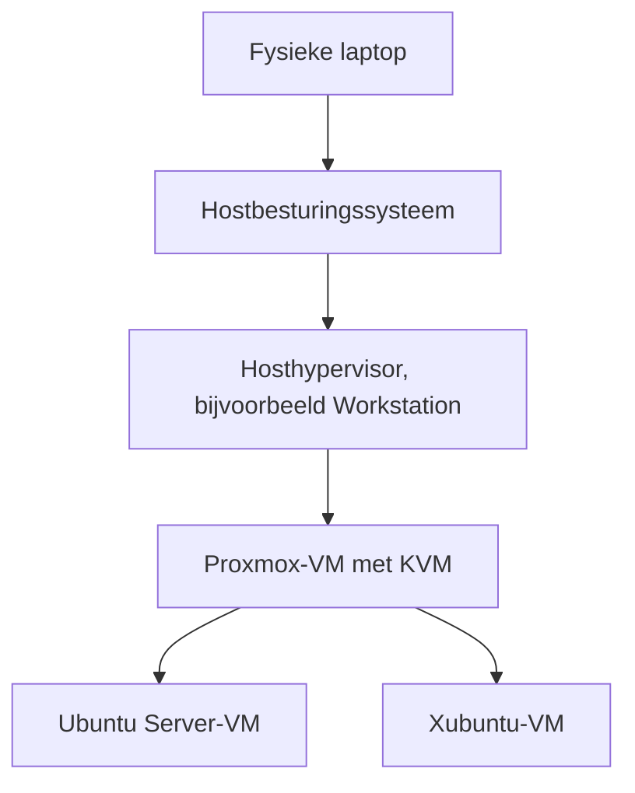
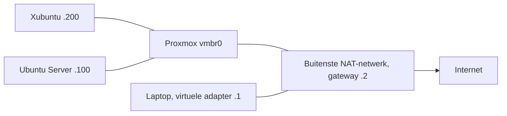

# Hypervisors en virtuele infrastructuur

Een IoT-toepassing bestaat vaak uit meer dan een sensor en een microcontroller. Meetwaarden komen terecht bij een broker, database of dashboard. Die software heeft een besturingssysteem, rekenkracht, geheugen, opslag en een netwerk nodig. In dit hoofdstuk leer je die onderlaag opbouwen met virtuele machines.

Je maakt een kleine omgeving waarin een Linux-server een website aanbiedt en een tweede Linux-machine die website gebruikt. Je bekijkt ook wat er gebeurt wanneer een onderdeel uitvalt. Zo leg je de basis voor de diensten en monitoring in latere hoofdstukken.

## 1. Een fysieke server delen

Zonder virtualisatie installeer je een besturingssysteem rechtstreeks op een computer. Dat systeem beheert de processor, het RAM, de disks en de netwerkinterfaces. Wanneer je voor elke kleine toepassing een aparte fysieke computer gebruikt, blijven resources vaak ongebruikt. Het vervangen of herstellen van een systeem vraagt bovendien werk aan die specifieke computer.

Een **hypervisor** maakt het mogelijk om meerdere virtuele machines, of VM's, op dezelfde fysieke computer te gebruiken. Elke VM krijgt virtuele hardware en draait een eigen besturingssysteem. De hypervisor verdeelt de fysieke resources over die VM's.

De fysieke computer is de **host**. Een besturingssysteem in een VM is een **gast**. Een Linux-gast kan tegelijk met een Windows-gast op dezelfde host draaien. De gasten hebben elk hun eigen kernel en systeemconfiguratie.

De scheiding is nuttig, maar de fysieke afhankelijkheid blijft bestaan. Als de enige host uitvalt, vallen alle VM's daarop uit. Meer VM's op één host bouwen levert dus geen automatische hoge beschikbaarheid op.

### Type I en type II

| Type | Plaats van de hypervisor | Voorbeeld |
| --- | --- | --- |
| Type I | Beheert virtualisatie rechtstreeks op de serverhardware | KVM zoals gebruikt door Proxmox VE, VMware ESXi |
| Type II | Werkt als toepassing op een bestaand hostbesturingssysteem | VMware Workstation, VirtualBox |

Proxmox VE is een beheerplatform rond onder meer KVM en LXC. In dit hoofdstuk gebruiken we KVM-VM's. Een Proxmox-node draait zelf op Linux. Dat betekent niet dat je hem daarom als een gewone type II-desktoptoepassing moet beschouwen. De plaats en werking van de virtualisatielaag bepalen het onderscheid. [Proxmox VE](https://www.proxmox.com/en/products/proxmox-virtual-environment/features)

### Nested virtualisatie

Op een eigen laptop installeren we Proxmox eventueel in een VM van een hosthypervisor. Binnen die Proxmox-VM maken we opnieuw VM's. Dat heet **nested virtualisatie**.

De buitenste hypervisor moet hardwarevirtualisatie doorgeven. Anders kan Proxmox wel starten terwijl de VM's daarin niet met KVM willen starten. Op een toegewezen fysieke Proxmox-server van de opleiding ontbreken de buitenste laptoplagen.

Nested virtualisatie laat je de beheertaken oefenen zonder een fysieke server te reserveren. De extra lagen vragen resources en kunnen de prestaties beïnvloeden. Bij problemen kijk je daarom eerst op welke laag de fout ontstaat.

**Denkvraag:** Proxmox werkt, maar beide gasten weigeren te starten met een KVM-fout. Waarom is het weinig zinvol om eerst de IP-adressen van de gasten te wijzigen?

## 2. De resources van een VM

### Processor

Een **vCPU** is een virtuele processor die de hypervisor op beschikbare fysieke rekencapaciteit inplant. Twee vCPU's betekenen niet dat de VM permanent twee fysieke cores bezit. VM's kunnen op dezelfde fysieke capaciteit wachten.

Je kunt meer vCPU's toewijzen dan de host gelijktijdig kan uitvoeren. Dat is een vorm van **overcommitment**. Voor rustige machines kan dat werken. Wanneer alle machines tegelijk rekenen, ontstaat concurrentie. Meer vCPU's instellen lost een overbelaste host dan niet vanzelf op.

### Geheugen

Een gast heeft RAM nodig voor zijn besturingssysteem en toepassingen. Ook de hypervisor en het hostbesturingssysteem vragen geheugen. In ons voorbeeld krijgen de gasten samen 5 GB uit de 8 GB van de Proxmox-VM. Het resterende budget is nodig voor Proxmox en overhead.

Een laptop met 16 GB heeft dus niet 16 GB vrij voor gasten. Als de host te veel geheugen naar disk moet verplaatsen, kan de hele omgeving traag worden. Gebruik in dit eerste labo vaste geheugentoewijzing, zodat het budget zichtbaar blijft.

### Opslag

De gast ziet een virtuele disk. De inhoud daarvan komt terecht in een bestand, volume of andere opslagstructuur van de hypervisor.

Bij **thin provisioning** reserveer je een maximale virtuele capaciteit zonder die meteen volledig fysiek te vullen. Twee disks van 24 GB kunnen in het begin minder dan 48 GB fysieke ruimte innemen. Zodra de gasten data schrijven, groeit het verbruik. Als de onderliggende opslag vol raakt, kunnen meerdere VM's tegelijk problemen krijgen.

Controleer daarom twee niveaus:

- In de gast: beschikbare ruimte van het eigen bestandssysteem, bijvoorbeeld met `df -h`.
- In Proxmox en op de laptop: beschikbare ruimte van de opslag waarop de virtuele disks staan.

De namen `local` en `local-lvm` verwijzen in veel installaties naar verschillende storage-definities. Een directory voor ISO-bestanden is niet automatisch de juiste plaats voor VM-disks. Bekijk het type en de toegestane inhoud in de beheerinterface.

### Virtuele hardware

Linux ondersteunt VirtIO-drivers voor onder meer disk- en netwerktoegang. Die laten de gast efficiënt met de hypervisor samenwerken. De **QEMU Guest Agent** is andere software: die kan bijvoorbeeld gastinformatie aan Proxmox doorgeven en bepaalde beheeracties ondersteunen. De agent vervangt de netwerkdriver niet.

**Denkvraag:** De gast meldt 15 GB vrije ruimte, maar de thin pool op Proxmox zit vol. Welk niveau moet je onderzoeken en waarom?

## 3. Het netwerk tussen de machines

### Netwerkkaart en bridge

Elke VM krijgt een virtuele netwerkkaart met een eigen MAC-adres. Een **Linux bridge**, in ons voorbeeld `vmbr0`, verbindt virtuele netwerkkaarten op laag 2. Ze vervult een vergelijkbare rol als een switch.

Een bridge maakt niet vanzelf een DHCP-server, router of internetverbinding aan. Dat zijn afzonderlijke functies. Bij route A koppelt Proxmox de gasten via de bridge aan zijn virtuele uplink. De buitenste hosthypervisor biedt het NAT-netwerk aan. Bij route B legt de opleiding de bridge, VLAN's en routing vast.

### Adres, subnet, gateway en DNS

| Instelling | Betekenis | Voorbeeld voor Ubuntu Server |
| --- | --- | --- |
| IPv4-adres | Adres van deze netwerkinterface | `192.168.77.100` |
| Prefix | Bepaalt welk netwerk lokaal bereikbaar is | `/24`, oftewel `255.255.255.0` |
| Default gateway | Router voor bestemmingen buiten het lokale subnet | `192.168.77.2` |
| DNS-server | Vertaalt namen naar adressen | De bevestigde DNS-forwarder `192.168.77.2` |

In `192.168.77.0/24` is `.0` het netwerkadres en `.255` het broadcastadres. Die geef je niet aan een gast. Vaste adressen reserveer je buiten de DHCP-pool, zodat een DHCP-server hetzelfde adres niet aan een andere machine uitdeelt.

Ubuntu Server `.100` en Xubuntu `.200` bevinden zich in dit voorbeeld in hetzelfde subnet. Hun onderlinge verkeer hoeft niet via de default gateway. Voor een pakketserver op internet gebruiken ze wel een route via de gateway.

### NAT en bereikbaarheid

**Network Address Translation**, of NAT, vertaalt adressen tijdens het doorsturen van verkeer. Daardoor kunnen de private VM's een uitgaande verbinding naar internet opzetten via de buitenste hypervisor.

Dit schema toont route A. Proxmox heeft voor zijn beheer ook een adres, hier `.10`, op `vmbr0`. Op school kan het beheeradres in een ander netwerk liggen.

Uitgaande internettoegang zegt niets over een route van je telefoon naar de gast. Je telefoon zit meestal op een ander netwerk. Een router, toegestane route of VPN moet die verbinding mogelijk maken. Voor hoofdstuk 1 volstaat de browser op Xubuntu als client.

### Netwerkbeheer in Linux

Ubuntu Server gebruikt in deze cursus Netplan met `systemd-networkd` als renderer. Een YAML-configuratie beschrijft de gewenste instellingen. De naam van de netwerkinterface moet overeenkomen met de echte interface, bijvoorbeeld `ens18` of `enp6s18`. Zoek die eerst op met `ip -br address`.

Xubuntu gebruikt NetworkManager. Daar passen we na installatie een bestaand verbindingsprofiel aan met `nmcli`. Een configuratiebestand voor Ubuntu Server blind kopiëren naar een desktopgast kan twee beheermethoden door elkaar laten werken. [NetworkManager](https://networkmanager.dev/docs/api/latest/nmcli.html)

Bij wijzigingen aan een netwerkconfiguratie kun je je eigen verbinding verliezen. Werk in de VM-console en bewaar de vorige instellingen. Met `netplan try` kun je een wijziging tijdelijk testen; controleer ook na een rollback welke configuratie op disk staat. [Netplan](https://netplan.readthedocs.io/en/stable/netplan-try/)

## 4. Een dienst bereikbaar maken

Een IP-adres identificeert een netwerkinterface. Een **poortnummer** maakt het mogelijk om op dat adres een specifieke dienst te benaderen.

| Dienst | Protocol in dit labo | Gebruik |
| --- | --- | --- |
| Proxmox-webbeheer | HTTPS, TCP 8006 | Infrastructuur beheren |
| OpenSSH | TCP 22 | Shell en SFTP |
| NGINX | HTTP, TCP 80 | De oefenwebsite aanbieden |

Een geslaagde `ping` toont dat ICMP-verkeer mogelijk is. Het bewijst niet dat NGINX op TCP 80 luistert. Om de webdienst te testen gebruik je een browser of `curl`.

### Lokaal en op afstand

`localhost` en `127.0.0.1` verwijzen naar de machine waarop je de test uitvoert. `curl http://localhost` op Ubuntu Server onderzoekt die server. Hetzelfde commando op Xubuntu onderzoekt Xubuntu.

Dat verschil helpt bij diagnose. Als NGINX lokaal antwoordt maar de client de website niet bereikt, ligt de oorzaak mogelijk bij luisteren op de juiste interface, firewallregels of het netwerkpad.

### SSH en SFTP

Met **SSH** voer je op afstand commando's uit. Bij de eerste verbinding controleert de client de hostsleutel van de server. Vergelijk de getoonde vingerafdruk met de waarde in de vertrouwde VM-console. De sleutel helpt je controleren met welke server je verbinding maakt.

**SFTP** is het SSH File Transfer Protocol. Je kunt ermee bestanden uploaden via dezelfde SSH-dienst. In dit labo upload je naar je eigen home-directory. Daarna plaats je de website met een gerichte beheeractie in de webroot. Je hoeft hiervoor geen aparte FTP-server te installeren.

## 5. Bestandsrechten voor een webserver

Linux kent een eigenaar, groep en rechten per bestand of directory. Voor een bestand betekenen `r`, `w` en `x` lezen, schrijven en uitvoeren. Voor een directory betekent `x` dat een proces de directory mag doorlopen. Een webserver moet dus ook de bovenliggende directories kunnen doorlopen om een bestand te lezen.

NGINX draait zijn workerprocessen in de gekozen Ubuntu-opstelling als `www-data`. Voor onze statische website krijgt die gebruiker leesrechten op HTML en CSS, maar geen schrijfrechten. De gepubliceerde bestanden zijn van `root`, met mode `0644`; de webdirectory krijgt `0755`.

De student beheert zijn bronbestanden in de home-directory en publiceert met `sudo install`. Een fout in de webdienst geeft zo niet meteen schrijfrechten op de websitebestanden. `chmod 777` zou iedere lokale gebruiker schrijfrechten geven en is hier geen passende oplossing.

De firewall laat alleen de bedoelde bronadressen en diensten toe. HTTP gebruiken we in dit eerste geïsoleerde labo voor een statische pagina zonder aanmeldgegevens. HTTPS voor aangeboden applicaties krijgt later een eigen uitwerking.

**Denkvraag:** Waarom is een geslaagde upload naar je home-directory geen bewijs dat NGINX dat bestand al kan aanbieden?

## 6. Storingen systematisch onderzoeken

Begin met een concrete vaststelling: welke client probeert welk adres en welke poort te bereiken? Verander daarna één ding tegelijk en bewaar het bewijs.

| Niveau | Voorbeeldcontrole | Wat je ermee onderzoekt |
| --- | --- | --- |
| Hypervisor | VM-status en taaklog | Draait de bedoelde machine? |
| Gastinterface | `ip -br address` | Staat het juiste adres op een actieve interface? |
| Routes | `ip route` | Is de route naar de bestemming aanwezig? |
| DNS | `resolvectl query archive.ubuntu.com` | Werkt naamomzetting? |
| Service | `systemctl status nginx` | Is de webservice gestart? |
| Luisterpoort | `sudo ss -ltnp` | Welk proces luistert op welke TCP-poort? |
| HTTP | `curl -I http://localhost` | Antwoordt de lokale webdienst? |
| Logs | `journalctl -u nginx` | Wat meldt de dienst? |

Een ontbrekend DNS-antwoord vraagt een ander onderzoek dan een HTTP-antwoord `403 Forbidden`. Bij die laatste fout heeft de client al een webserver bereikt. Je onderzoekt dan onder meer de documentroot en bestandsrechten.

## 7. Snapshot en back-up

Een **snapshot** bewaart een terugkeerpunt van de VM op snapshotgeschikte opslag. Afhankelijk van de gekozen optie kan ook het werkgeheugen worden vastgelegd. Wij gebruiken een disksnapshot van een netjes afgesloten VM. Daardoor hoeven we in dit eerste labo geen live-geheugentoestand of applicatieconsistentie te beheren.

Een snapshot staat in dezelfde opslagomgeving als de actieve VM. Hij is geschikt om snel een wijziging terug te draaien. Verlies je die opslag, dan kan ook de snapshot verloren zijn.

Een **back-up** is een afzonderlijke herstelkopie. In het labo maken we een gestopte VM-back-up naar een toegewezen back-upstorage. Voor bescherming tegen een defecte host moet die kopie ook buiten die host of fysieke opslag bewaard worden. Een tweede bestand op dezelfde SSD biedt die bescherming niet.

Een groen back-uplog bewijst dat de back-uptaak is voltooid. Pas door een restore uit te voeren en het resultaat te testen, toon je aan dat je ermee kunt herstellen.

### De identiteit van een herstelde machine

Een herstelde kopie kan dezelfde hostname, statische IP-configuratie en SSH-hostsleutels bevatten als het origineel. Een nieuw MAC-adres alleen voorkomt een conflict met het vaste IP niet. We starten de kopie daarom eerst met losgekoppelde netwerkkaart en testen de website in de console via `localhost`.

Bij een echte vervanging kan de oorspronkelijke identiteit gewenst zijn. Bij een extra machine moet je die bewust aanpassen. In dit hoofdstuk blijft de kopie na de controle uitgeschakeld en behouden we het origineel.

## 8. Zelfcontrole

Beantwoord de vragen in eigen woorden voordat je het labo afrondt.

1. Welke resources delen de twee gasten en wat gebeurt er bij uitval van de enige Proxmox-host?
2. Wat is het verschil tussen een bridge, een default gateway en NAT?
3. Waarom kan een client de server pingen terwijl de website onbereikbaar is?
4. Waarom kan een DNS-fout pakketinstallatie blokkeren terwijl toegang via een IP-adres wel werkt?
5. Waarom krijgt `www-data` in deze opstelling leesrechten en geen schrijfrechten?
6. Welk probleem lost een snapshot snel op en tegen welk verlies beschermt hij niet?
7. Welke maatregelen voorkomen dat een restoretest het oorspronkelijke systeem verstoort?

Vergelijk je antwoorden na de oefening met de [modeloplossingen](oplossingen.md#antwoorden-op-de-zelfcontrole).

## Bronnen en verdieping

- [Proxmox VE documentatie en beheergids](https://www.proxmox.com/en/downloads/proxmox-virtual-environment/documentation)
- [Ubuntu Server netwerkconfiguratie](https://documentation.ubuntu.com/server/explanation/networking/configuring-networks/)
- [Netplan try](https://netplan.readthedocs.io/en/stable/netplan-try/)
- [NetworkManager nmcli](https://networkmanager.dev/docs/api/latest/nmcli.html)
- [Ubuntu Server NGINX installeren](https://documentation.ubuntu.com/server/how-to/web-services/install-nginx/)

De oorspronkelijke inhoud van les 1 en labo 1 uit `base` vormt de basis voor de hypervisorvergelijking en de opdracht met Ubuntu Server, Xubuntu en NGINX. De uitleg over diagnose, rechten en herstel is uitgebreid voor dit leerpad.
