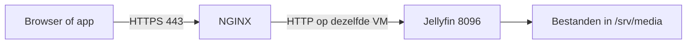

# Een dienst aanbieden op een server

In hoofdstuk 1 stond je website op een eigen virtuele machine (**VM**, *Virtual Machine*). Vandaag maak je sneller een nieuwe VM en bied je daarop een mediadienst aan met Jellyfin. Je opent die dienst vanaf een andere computer. Die gebruiker van de dienst heet de **client**; de VM die de dienst aanbiedt is de **server**. Het volledige webadres, met bijvoorbeeld `https://` ervoor, heet een **URL** (*Uniform Resource Locator*). Als de opleiding een **VPN** (*Virtual Private Network*) voorziet, kan dat ook buiten het lokaal. Zo’n VPN is een beveiligde netwerkverbinding waarmee je vanop afstand het labnetwerk bereikt.

We oefenen daarmee een deel van het werk dat je bij een cloudprovider, dus een aanbieder van clouddiensten, uitvoert. Je hebt geen abonnement, kredietkaart of persoonlijke cloudaccount nodig.

## 1. Wat betekent cloud?

Stel dat een bedrijf een extra server nodig heeft. Het kan een computer kopen, kabels aansluiten en een besturingssysteem installeren. In documentatie heet dat ook **OS** (*Operating System*). Het kan ook via een beheerpagina rekenkracht, geheugen en opslag aanvragen uit een al beschikbare verzameling servers.

Dat tweede idee hoort bij cloud computing. Typische kenmerken zijn:

| Kenmerk | Concreet voorbeeld |
| --- | --- |
| Zelf iets aanvragen | Je maakt via een beheerpagina een nieuwe VM. |
| Bereikbaar via het netwerk | Je gebruikt de dienst vanaf je laptop. |
| Hardware delen | Meerdere klanten of teams gebruiken dezelfde verzameling servers, met gescheiden toegang. |
| Snel groter of kleiner maken | Je past capaciteit aan wanneer de vraag verandert. |
| Verbruik meten | Je volgt op hoeveel geheugen, opslag of rekentijd gebruikt wordt. |

Een website die ergens anders staat, is dus niet automatisch een volledige cloudomgeving. Onze Proxmox-opstelling toont bijvoorbeeld VM-beheer en gedeelde hardware. Ze biedt niet vanzelf onbeperkte capaciteit, facturatie of automatische schaalvergroting. **NIST** is het *National Institute of Standards and Technology*, een Amerikaans instituut dat onder meer technische richtlijnen publiceert. [De clouddefinitie van NIST](https://csrc.nist.gov/pubs/sp/800/145/final) beschrijft die kenmerken.

## 2. Wie beheert welk deel?

Je komt vaak drie afkortingen tegen. Denk telkens aan dezelfde toepassing die een bedrijf online wil zetten.

- **IaaS** (*Infrastructure as a Service*, infrastructuur als dienst): je krijgt bijvoorbeeld een VM. Jij installeert het OS en de toepassing en voert updates uit. Dat lijkt op ons labo.
- **PaaS** (*Platform as a Service*, een platform als dienst): je krijgt een kant-en-klare plek om je eigen toepassing te draaien. De aanbieder beheert meer van het systeem eronder.
- **SaaS** (*Software as a Service*, software als dienst): je gebruikt een afgewerkt programma via het netwerk, bijvoorbeeld webmail. Je hoeft de mailserver zelf niet te installeren.

Bij elke vorm hou je eigen taken. Je moet bijvoorbeeld je accounts beveiligen en bepalen wie je gegevens mag zien. Vraag dus niet alleen ‘staat het in de cloud?’, maar ook ‘welke onderdelen moet ik zelf beheren?’.

## 3. Eigen servers of een provider

**Public cloud** is een dienst van een externe aanbieder die capaciteit aan meerdere klanten aanbiedt. **Private cloud** is voor één organisatie bedoeld. Een **hybride** aanpak combineert eigen systemen met diensten bij een aanbieder.

Je hoeft in dit hoofdstuk geen externe aanbieder te kiezen. Als je je VM bij de opleiding draait, beheert de opleiding de fysieke machines. Jij blijft verantwoordelijk voor de accounts en toepassing in jouw VM.

Denk ook aan kosten zonder factuur per uur. De opleiding betaalt hardware, stroom, opslag en beheer. Meer VM's maken heeft dus ook daar gevolgen. Een VM uitzetten maakt haar schijf niet leeg en geeft die opslag niet automatisch vrij.

## 4. Een template bespaart installatiewerk

Een **template** is een voorbereid vertrekpunt voor nieuwe VM's. In plaats van opnieuw de installer te doorlopen, maak je een kopie van dat vertrekpunt.

**Cloud-init** is een programma dat de eerste inrichting van een nieuwe VM uitvoert. Je geeft vooraf instellingen mee. Bij de eerste start past het programma ze toe: computernaam, gebruiker, SSH-sleutel en netwerkinstellingen. Iedere kopie krijgt haar eigen gegevens. Elke student houdt zo een eigen VM en eigen sleutels. Het wachtwoord van de laboaccounts is wel steeds `Student123`.

We gebruiken een voorbereid Ubuntu Server-template. Een **full clone** maakt een zelfstandige kopie van de schijf. Dat is voor deze oefening eenvoudig te bewaren. Een kopie van een reeds gebruikte VM zonder voorbereiding kan daarentegen dezelfde naam, IP-adressen en sleutels houden. Denk aan de hersteltest uit hoofdstuk 1.

## 5. Aanmelden met een SSH-sleutel

Tot nu toe kon je met een wachtwoord aanmelden. **SSH** (*Secure Shell*) is de beveiligde verbinding waarmee je op afstand commando’s uitvoert. Je kunt die verbinding ook met een sleutelpaar openen:

- De **publieke sleutel** mag naar de server. Die geeft aan welke sleutel de server mag herkennen.
- De **private sleutel** blijft op je eigen computer. Daarmee bewijs je dat jij de bijbehorende sleutel bezit.

Gebruik `Student123` als wachtzin voor de private sleutel in dit labo. De publieke sleutel eindigt vaak op `.pub`. Controleer goed welk bestand je uploadt. De hostsleutel van de server blijft een aparte controle: die helpt jou de juiste server herkennen.

## 6. Jellyfin en de bestanden die het leest

Jellyfin maakt een mediabibliotheek die je in een browser of app kunt gebruiken. De server heeft daarvoor toegang tot de mediabestanden nodig.

We bewaren testmedia in `/srv/media`, apart van de programmainstallatie. De gebruiker `student` mag daar bestanden plaatsen. De servicegebruiker `jellyfin` mag ze lezen. Hiervoor gebruiken we de groep `jellyfin`. Dat is een vervolg op de rechten uit hoofdstuk 1.

Gebruik eigen opnames of kleine vrije testbestanden. We gaan geen grote films downloaden. Afspelen zonder omzetten, **direct play**, vraagt minder rekenwerk dan een video op de server naar een ander formaat omzetten.

## 7. Toegang via HTTPS

Jellyfin gebruikt intern HTTP op poort 8096. We zetten daarvoor NGINX als **reverse proxy**: de browser spreekt NGINX aan, en NGINX geeft de vraag door aan Jellyfin.

**HTTP** (*Hypertext Transfer Protocol*) regelt de vragen en antwoorden tussen browser en webserver. **HTTPS** is HTTP met een beveiligde verbinding. Daarvoor gebruikt het **TLS** (*Transport Layer Security*): de beveiliging die de gegevens onderweg versleutelt.

Een **certificaat** is een digitaal document dat het serveradres aan een publieke sleutel koppelt. De uitgever ondertekent dat document. Een vertrouwde **CA** (*Certificate Authority*, certificaatuitgever) helpt je browser controleren wie het document uitgaf. De opleiding voorziet een lab-CA en een certificaat dat bij je labadres past. De docent toont hoe je de publieke lab-CA op je client vertrouwt. Je koopt geen domeinnaam en zet geen publieke poort op je thuisrouter open.

Het certificaat maakt de VM niet automatisch vanaf overal bereikbaar. Daarvoor blijft een netwerkroute of VPN nodig. De interne Jellyfin-poort houden we van het clientnetwerk afgeschermd.

## 8. Werkt het voor een gebruiker?

Een geslaagde SSH-login betekent nog niet dat de mediadienst werkt. Test de hele weg: client, HTTPS, aanmelding en een klein bestand afspelen.

Maak een apart kijkaccount naast je beheeraccount. Beide gebruiken `Student123`. Je hoeft voor het bekijken van media geen serverbeheerder te zijn.

Je bewijst ook dat data bewaard blijft. Stop en start de dienst. Is de bibliotheek nog aanwezig? Verwijder geen gebruikersdata om een herstart te testen.

## Kun je dit uitleggen?

1. Welk werk neemt het template je uit handen?
2. Welke van je twee SSH-sleutelbestanden blijft op je eigen computer?
3. Wie beheert in ons labo de fysieke server en wie de Jellyfin-accounts?
4. Waarom werkt HTTPS pas goed als zowel het certificaat als de netwerkroute klopt?
5. Welke cloudkenmerken oefen je echt en welke levert deze opstelling nog niet?

## Bronnen

- [NIST over cloud computing](https://csrc.nist.gov/pubs/sp/800/145/final)
- [Jellyfin op Linux](https://jellyfin.org/docs/general/installation/linux/)
- [Jellyfin en netwerktoegang](https://jellyfin.org/docs/general/networking/)
- [Proxmox-documentatie](https://www.proxmox.com/en/downloads/proxmox-virtual-environment/documentation)
