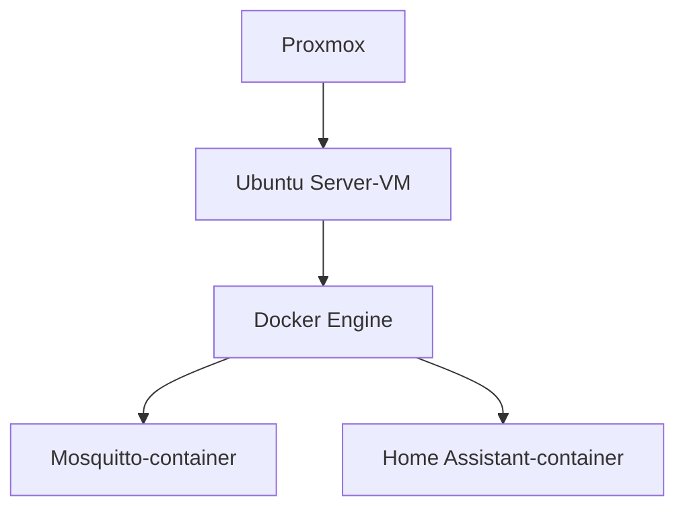

# Twee programma's in containers

Je wilt een MQTT-broker en een dashboard installeren. Dat kan rechtstreeks op Ubuntu, zoals NGINX in hoofdstuk 1. Maar programma's hebben soms andere bibliotheken, versies en bestanden nodig. Containers helpen om de onderdelen van één toepassing bij elkaar te houden.

Vandaag laat je een fictieve deur open en dicht gaan. Je verstuurt een bericht en ziet de toestand in Home Assistant veranderen. Er is geen echte deursensor nodig.

## 1. Een image en een container

Een **image** is een pakket met een programma en wat het nodig heeft om te draaien. Je downloadt het bijvoorbeeld uit een containerregister. **Docker Hub** en **GHCR** zijn zulke registers.

Een **container** is een draaiende of gestopte uitvoering van zo'n image. Denk aan een installatiepakket en het programma dat je ermee start: de twee horen bij elkaar, maar zijn niet hetzelfde.

Van één image kun je meerdere containers starten. Elke container heeft zijn eigen instellingen en tijdelijke bestanden.

## 2. Het verschil met een VM

Een VM heeft haar eigen besturingssysteem en kernel. Een container deelt de kernel van de computer waarop de containerengine draait. Een container is dus geen kleine hypervisor.

In ons labo is de volgorde:

We installeren Docker in een gewone Ubuntu-VM, niet rechtstreeks op Proxmox en niet in een LXC-container. Zo blijven de stappen voor iedereen gelijk.

**Docker Engine** start en beheert de containers. Het commando `docker` praat met die engine. We gebruiken `sudo docker`, omdat toegang tot de Docker-engine veel rechten geeft op deze VM.

## 3. Wat blijft bewaard?

Verwijder je een container, dan verdwijnt zijn eigen schrijflaag. Daarom zet je belangrijke data erbuiten.

- Een **bind mount** maakt een map op de VM zichtbaar in de container. Onze Home Assistant-configuratie staat zo in `./homeassistant`.
- Een **volume** is opslag die Docker apart beheert. Mosquitto bewaart daarin onder meer de laatste berichten.

`docker compose down` verwijdert de containers en het bijbehorende netwerk. De genoemde volumes blijven staan. `down -v` verwijdert ook die volumes. Gebruik die laatste optie hier dus niet.

Een herstart en het opnieuw maken van een container zijn verschillende tests. Je oefent beide.

## 4. Poorten binnen en buiten de container

Mosquitto luistert **in** de container op poort 1883. Met `ports` verbind je een poort op de VM met die containerpoort.

Ons voorbeeld `127.0.0.1:1883:1883` betekent: alleen via het eigen loopbackadres van de VM is die poort bereikbaar. Niet rechtstreeks vanaf elke machine op het netwerk.

Vanaf Xubuntu maken we een SSH-tunnel. Daarmee stuur je een lokale poort op Xubuntu veilig door naar de VM. Je gebruikt bijvoorbeeld op Xubuntu poort 11883 en bereikt daarmee Mosquitto op de server.

Docker-poorten kunnen gewone UFW-regels omzeilen. Daarom vertrouwen we hier niet op alleen UFW om een gepubliceerde containerpoort af te schermen. We binden de poorten aan loopback en gebruiken SSH. Voor toegang vanaf een telefoon kan de opleiding later een passende VPN/proxyroute voorzien.

## 5. Waarom Compose?

Met `docker run` beschrijf je één container in een commando. Dat is nuttig om te leren wat de opties doen.

Bij meerdere programma's wordt zo'n reeks commando's snel onoverzichtelijk. **Docker Compose** leest een bestand `compose.yaml`. Daarin staan images, poorten, mappen en opstartinstellingen samen.

In één Compose-project kunnen containers elkaar via hun servicenaam vinden. Home Assistant gebruikt daarom `mosquitto` als brokeradres. Het hoeft het tijdelijke container-IP niet te kennen.

Die naam geldt **binnen** het containernetwerk. Op Xubuntu gebruik je de SSH-tunnel, niet zomaar het adres `mosquitto`.

## 6. MQTT met een deur als voorbeeld

MQTT werkt met berichten. Een **broker** ontvangt ze en geeft ze door aan geabonneerde clients.

Een bericht heeft een **topic**, bijvoorbeeld `iot/labo/deur`, en een inhoud of **payload**, bijvoorbeeld `OPEN`.

- De sensorclient **publiceert** `OPEN` of `DICHT`.
- Home Assistant **abonneert** zich op het topic en toont de toestand.

Met **retain** bewaart de broker het laatste bericht voor nieuwe abonnees. Home Assistant kan daardoor na een herstart meteen zien wat de laatste bekende deurtoestand was. Zonder nieuw bericht weet je daarmee niet of een echte sensor nog online is. Een beschikbaarheidstopic is een mogelijke uitbreiding.

We maken twee accounts, allebei met wachtwoord `Student123`. `sensor` mag alleen in `iot/labo/#` schrijven. `dashboard` mag die berichten lezen. Een **ACL** legt die topicrechten vast. Een correct wachtwoord geeft dus nog niet automatisch toegang tot elk topic.

In dit labo gaat MQTT via een SSH-tunnel. Voor rechtstreeks gebruik over een onvertrouwd netwerk heb je bijvoorbeeld MQTT met TLS of een beschermde VPN-route nodig.

## 7. Home Assistant Container

We gebruiken de officiële Home Assistant Container-image. Dat is niet hetzelfde als Home Assistant OS met de beheerde apps die vroeger add-ons heetten. Daarom installeren we Mosquitto als een aparte container.

Onze fictieve deur heeft geen Bluetooth, USB of automatische ontdekking nodig. We gebruiken dus geen extra apparaatdoorgifte, hostnetwerk of algemene privileged-modus voor Home Assistant.

Een **binary sensor** heeft twee toestanden. Met `payload_on: OPEN` en `payload_off: DICHT` vertel je hoe onze berichten moeten worden gelezen.

## 8. Versies en updates

Een image-tag kiest een versie. We gebruiken concrete tags in plaats van `latest`. Noteer ook de image-digest die je werkelijk hebt opgehaald. Een digest identificeert de inhoud preciezer dan een tag.

Een update doe je bewust: maak een back-up van data en configuratie, wijzig de versie, haal het image op en maak de container opnieuw. Test daarna. Alleen de container opnieuw starten haalt geen nieuwe imageversie op.

Compose op één VM is ook nog geen cluster dat automatisch naar een andere fysieke server uitwijkt. Kubernetes en Swarm zijn voorbeelden van systemen om meerdere hosts te beheren. In dit labo zetten we geen extra cluster op.

## Kun je dit uitleggen?

1. Wat download je: een image of een draaiende container?
2. Waarom blijft de Home Assistant-configuratie bewaard als je de container opnieuw maakt?
3. Welk brokeradres gebruikt Home Assistant, en welk adres gebruikt de client op Xubuntu?
4. Wat is het verschil tussen een fout wachtwoord en een topic dat niet is toegestaan?
5. Waarom gebruiken we voor deze poorten een SSH-tunnel in plaats van alleen UFW?

## Bronnen

- [Docker installeren op Ubuntu](https://docs.docker.com/engine/install/ubuntu/)
- [Docker Compose](https://docs.docker.com/compose/intro/features-uses/)
- [Home Assistant Container](https://www.home-assistant.io/installation/linux/)
- [MQTT binary sensor](https://www.home-assistant.io/integrations/binary_sensor.mqtt/)
- [Mosquitto-authenticatie](https://mosquitto.org/documentation/authentication-methods/)
